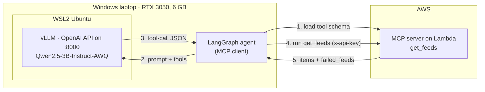

# geopolitical-news-agent-vLLM

A LangGraph news briefing agent running on a self-hosted Qwen model (vLLM), calling a `get_feeds` MCP tool hosted on AWS Lambda.

This is the self-hosted version of an agent I also built on Amazon Bedrock AgentCore, Microsoft Foundry and Google Cloud. All four call the same MCP server. Here, the model runs on a laptop GPU: no model API, and the weights never leave the machine.

## How it works



1. The agent connects to the MCP server with `langchain-mcp-adapters` and loads `get_feeds` and its schema from the server.
2. It sends the question and the tool schema to Qwen through vLLM's OpenAI-compatible API.
3. Qwen replies with a tool call, for example `get_feeds(feed=["bbc_world", "hindu_international"], keyword="Ukraine")`.
4. The agent runs that call against the Lambda server, sending the API key in the `x-api-key` header.
5. The results go back to Qwen, which writes a short briefing with a link for each headline.

**vLLM never talks to MCP.** It only serves the model and returns tool-call JSON. The LangGraph agent is the MCP client.

The MCP server lives in its own repo: [RajkiranVS/geo-news-mcp-server](https://github.com/RajkiranVS/geo-news-mcp-server). It reads three allowlisted RSS feeds (`bbc_world`, `hindu_international`, `hindu_national`). The agent picks feeds by name and never by URL.

## Repository layout

| Path | What it does |
| --- | --- |
| `agent.py` | Builds the agent (`create_agent` + `ChatOpenAI` pointed at vLLM), turns on MLflow tracing and runs one query |
| `system_prompt.md` | When to call `get_feeds`, how to pick feeds and keywords, and how to write the cited briefing |
| `src/feeds.py` | Connects to the Lambda MCP server over Streamable HTTP and returns its tools |
| `src/fetch_api_key.py` | Reads the MCP server's API key from AWS Secrets Manager |

## Requirements

- **Linux or WSL2.** vLLM does not support native Windows. On Windows, run vLLM inside WSL2 (Ubuntu); the agent can run on either side, because WSL2 forwards `localhost:8000` to Windows.
- **An NVIDIA GPU with at least 6 GB of VRAM.** The 3B AWQ model fits in 6 GB with a 4,096-token context.
- **Python 3.12 for vLLM** (its GPU dependencies lag newer Python versions) and **Python 3.13 for the agent**, managed with [uv](https://docs.astral.sh/uv/).
- **The MCP server deployed on AWS Lambda**, with its API key in AWS Secrets Manager as JSON: `{"api_key": "..."}`.
- **AWS credentials** that allow `secretsmanager:GetSecretValue` on that secret.

## Setup

### 1. Start vLLM (in WSL2 or Linux)

```bash
uv venv ~/vllm-env --python 3.12
source ~/vllm-env/bin/activate
uv pip install vllm --torch-backend=auto

vllm serve Qwen/Qwen2.5-3B-Instruct-AWQ \
  --enable-auto-tool-choice --tool-call-parser hermes \
  --max-model-len 4096 --gpu-memory-utilization 0.85 \
  --port 8000
```

- `--enable-auto-tool-choice` and `--tool-call-parser hermes` turn on tool calling for Qwen. Without them, the model replies in plain text and never calls the tool.
- The first run downloads about 2 GB of weights. The server is ready when the log shows `Application startup complete`.
- If it runs out of memory, lower `--gpu-memory-utilization` to `0.8` or `--max-model-len` to `2048`. Stop Ollama or anything else that holds GPU memory first.

Check that it is up:

```bash
curl http://localhost:8000/v1/models
```

### 2. Configure the agent

```bash
git clone https://github.com/RajkiranVS/geopolitical-news-agent-vLLM.git
cd geopolitical-news-agent-vLLM
uv sync
cp .env.example .env   # then fill in your values
```

| Variable | Required | Description |
| --- | --- | --- |
| `mcp_url` | Yes | Your Lambda Function URL, ending in `/mcp` |
| `secrets_id` | Yes | Name or ARN of the Secrets Manager secret holding the API key |
| `aws_region` | Yes | Region of that secret, for example `us-east-1` |
| `MLFLOW_TRACKING_URI` | No | Defaults to `http://127.0.0.1:5000` |
| `MLFLOW_EXPERIMENT` | No | Defaults to `geopolitical-agent` |

### 3. Start MLflow (for traces)

```bash
uv run mlflow server --backend-store-uri sqlite:///mlflow.db --port 5000
```

Every model call, tool call and agent step is logged as a span. Open `http://127.0.0.1:5000` and go to **Traces** to see each run: `geopolitical_agent` → `model` → `get_feeds` → `model`.

### 4. Run it

```bash
uv run --env-file .env agent.py
```

```
Ask me anything about any geopolitical updates: Latest on Bangladesh
Agent Response: ...
```

## What I saw in testing

I traced eight runs with MLflow. Each took about 3.5 to 9 seconds end to end.

| Behaviour | What happened |
| --- | --- |
| Tool calls | Valid every time: allowlisted feed names, `feed` as a list, sensible keywords |
| Empty results | For three made-up country pairs, it said there were no matching headlines instead of inventing any |
| Citations | Inconsistent: some briefings linked every headline, one solid answer had no links |
| Consistency | The same question (India–China relations) found nothing on one run and real headlines on the next |
| Feed choice | Often picked one feed where all three fitted |
| Looping | One run ("Latest on Ukraine?") kept calling the tool and hit the recursion limit |

None of these were server problems. They are the limits of a 3B model, and they need guards in code rather than more prompt rules.

## Known issues and next steps

- **Step limit.** `recursion_limit` is set to 6 so the prompt's one retry on empty results can finish. If the model keeps calling the tool, the agent stops and returns a fallback message. Next: replace this with middleware or a custom `StateGraph` that caps tool calls and forces a final answer.
- **Missing links.** Add a check that every bullet in the briefing carries a link from the tool result, and retry or flag the answer if not.
- **Context size.** Each tool result is about 1,500 tokens, so more than a couple of tool rounds overflows the 4,096-token context. A larger GPU allows a bigger context or a larger model, such as Qwen3-4B AWQ.
- **Evals.** Run the same citation evals used for the hosted-model versions, so the grounding gap between a 3B model and a frontier model is measured rather than estimated.

## Related repos

- MCP server on AWS Lambda: [RajkiranVS/geo-news-mcp-server](https://github.com/RajkiranVS/geo-news-mcp-server)
- Google Cloud version (ADK on Vertex AI Agent Engine): [RajkiranVS/geopolitical-news-agent-gcp](https://github.com/RajkiranVS/geopolitical-news-agent-gcp)
